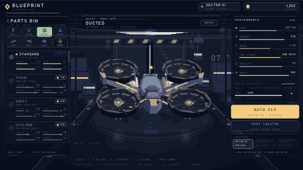
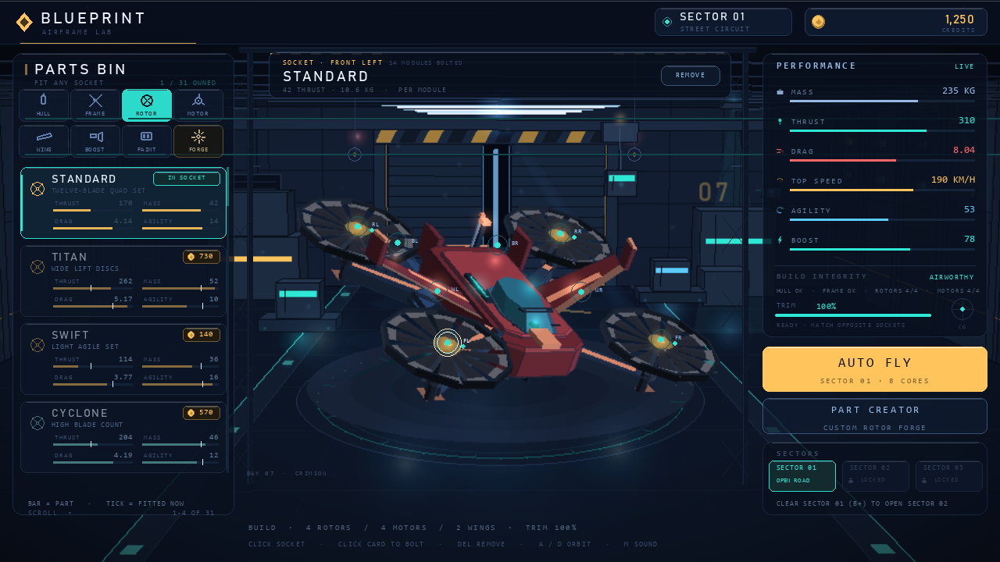
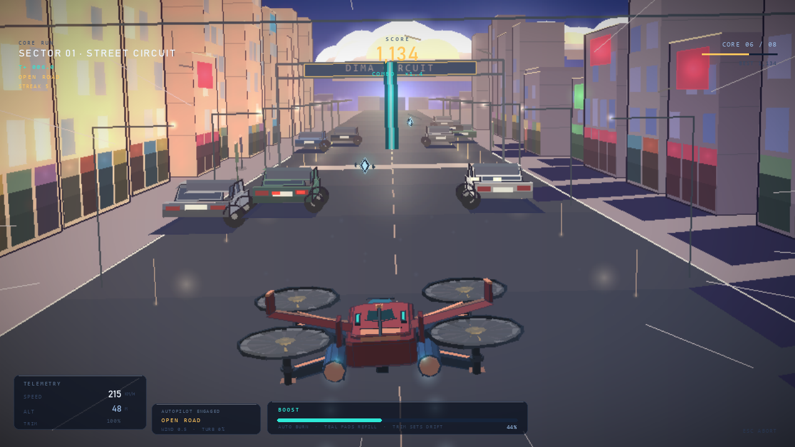
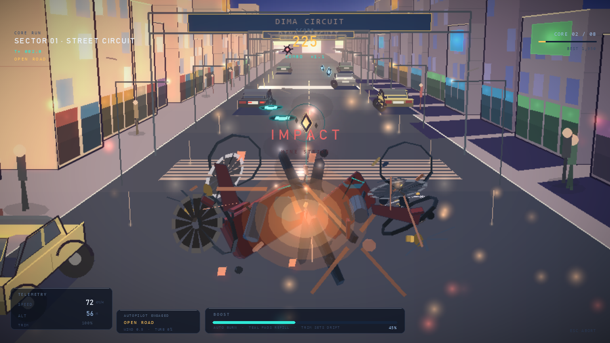

# Blueprint

**Drone builder and city flight — a work-in-progress prototype in Python and pygame.**



Blueprint is a small 3D game running on a hand-written software renderer: no engine, no OpenGL, no shader. Every frame is numpy geometry rendered into a 960x540 buffer and scaled up, which keeps it playable on an old integrated-graphics laptop.

## What works today

- **Hangar**: choose a hull, frame, four rotors, four motors, wings and two boosters. 191 parts across six slots, each with its own price, description and stats.
- **Part creator** (C): sliders for span, chord, blades, sweep and thickness; the mesh rebuilds live while you drag.
- **Flight**: an autopilot run down a city street sector with traffic, gates, mines and boosters.
- **Build faults**: parts that do not fit a hull or frame stall, clash blades or snap mid-flight.
- **Economy**: earn credits, unlock parts, keep your best runs.




## Run it

Python 3.11+, pygame 2.6, numpy.

```bash
pip install pygame numpy
python main.py
```

Headless checks and preview stills:

```bash
python main.py --selftest
python main.py --shots
```

## Controls

| Key | Action |
|---|---|
| A / D or arrows | Rotate the drone in the hangar |
| C | Open the part creator |
| Enter / Space | Take off |
| Esc | Pause, or back out of a run |
| M | Mute |
| R / N | Retry or go to the next sector on the result screen |

## Performance

Roughly 30 ms per frame on a 2013 laptop with integrated graphics. The renderer is single-threaded Python plus numpy, so a modern machine has plenty of headroom.

## Status

Prototype under active development. Part balance, visuals and the flight model still change between builds. The screenshots and the clip above are from the current build.


